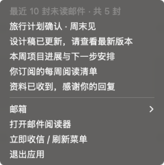
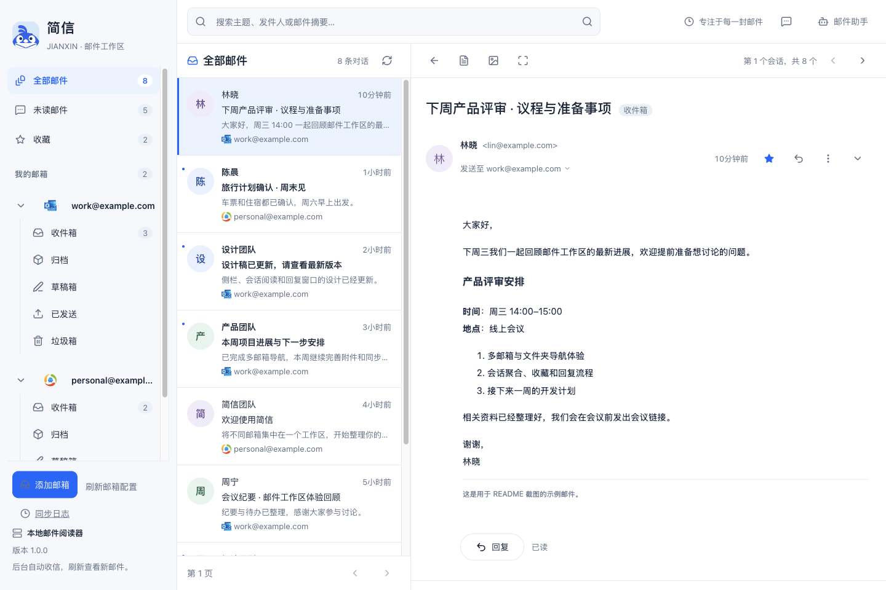
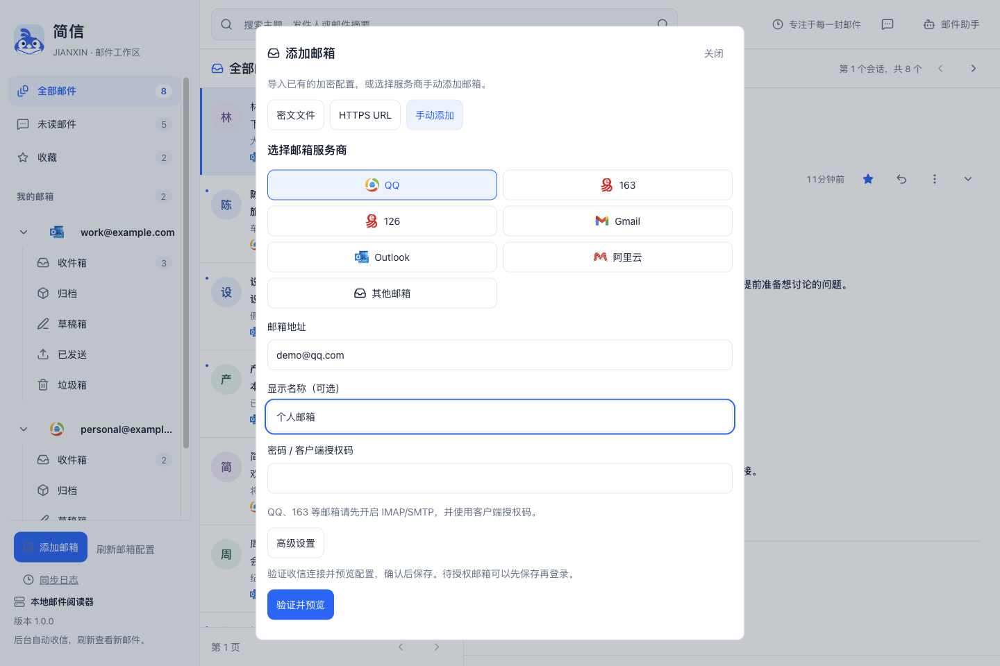
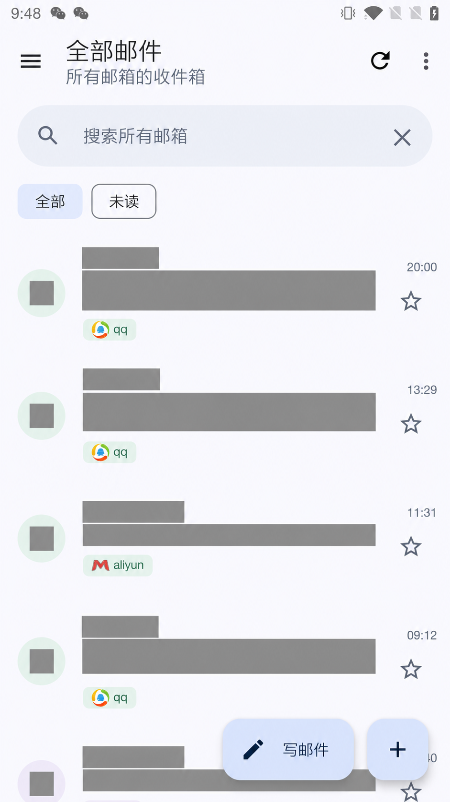
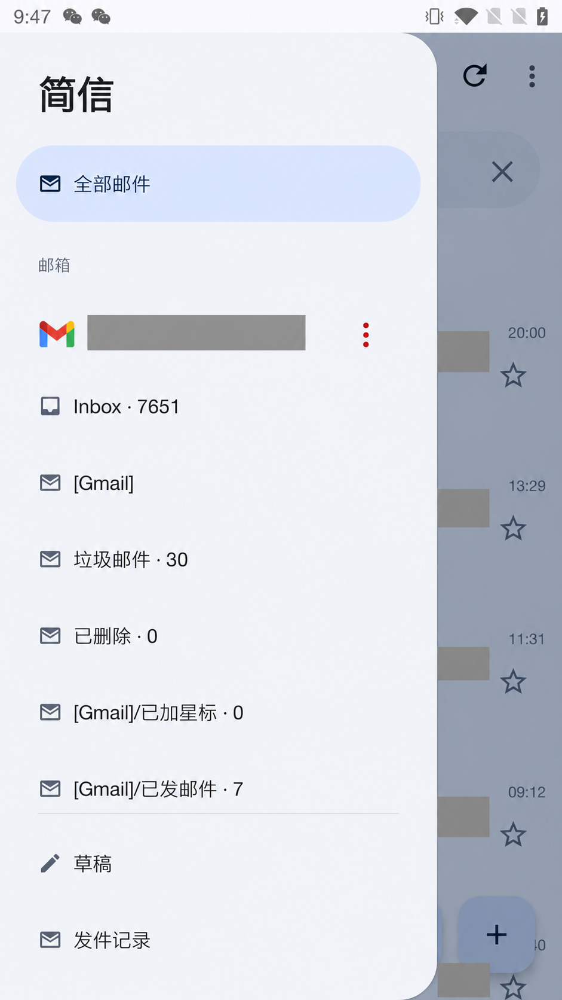
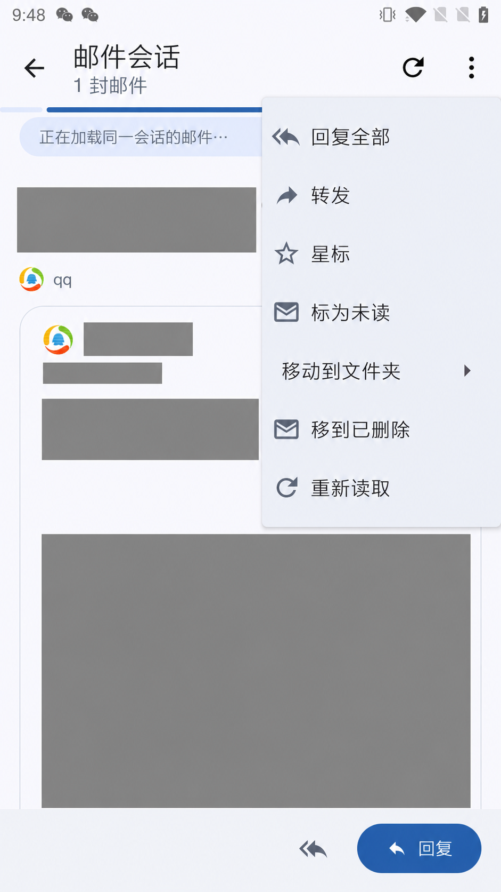
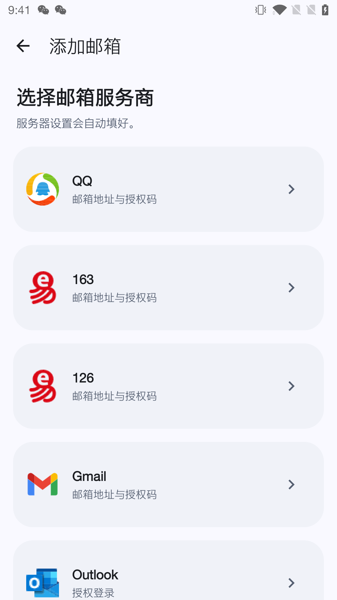
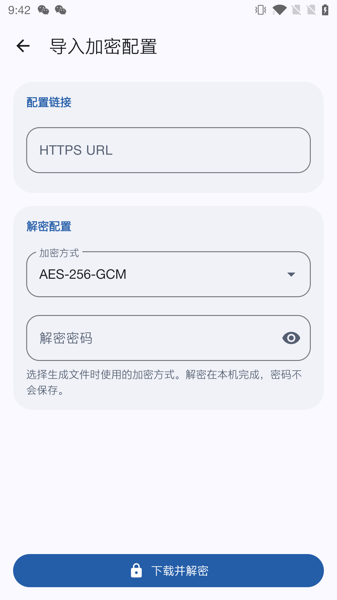
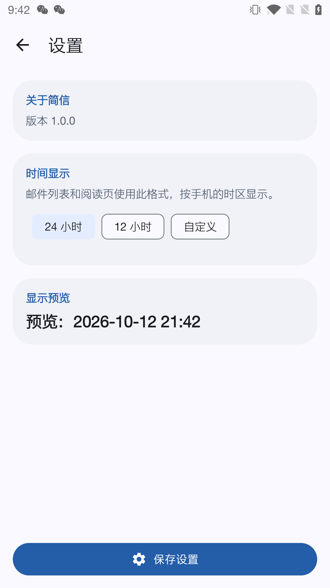

<div align="center" data-n="readme-header">
  
  <h1 data-n="readme-title">简信 · Jianxin</h1>
  <p data-n="readme-tagline"><strong>多个邮箱，一处阅读。</strong></p>
  <p data-n="readme-description">通过桌面托盘与浏览器、终端或原生移动应用管理邮箱，使用 IMAP / SMTP 收发邮件。</p>
  <p data-n="readme-badges">
    <a href="https://github.com/ltaoo/jianxin/actions/workflows/desktop.yml" data-n="readme-ci-link"></a>
    <a href="Cargo.toml" data-n="readme-rust-link"></a>
    <a href="#支持平台" data-n="readme-platform-link"></a>
  </p>
  <p data-n="readme-navigation">
    <a href="#主要功能" data-n="readme-features-link">主要功能</a> ·
    <a href="#界面预览" data-n="readme-preview-link">界面预览</a> ·
    <a href="#快速开始" data-n="readme-start-link">快速开始</a> ·
    <a href="#密文与多设备同步" data-n="readme-encrypted-sync-link">密文与多设备同步</a> ·
    <a href="#文档" data-n="readme-docs-link">文档</a> ·
    <a href="#开发与贡献" data-n="readme-contributing-link">参与贡献</a> ·
    <a href="https://github.com/ltaoo/jianxin/issues" data-n="readme-issues-link">反馈问题</a>
  </p>
</div>

---

## 主要功能

- **统一阅读** — 集中浏览多个邮箱，按账号和文件夹切换，筛选未读、搜索邮件、收藏重要内容。
- **对话聚合** — 将同一会话中的来往邮件放在一起，过滤同一邮箱不同文件夹中的邮件副本。
- **桌面常驻** — 启动后显示托盘并提供本地 Web 服务，后台收信、接收系统通知，点击托盘在浏览器中打开邮件。
- **本地阅读** — 桌面、CLI、TUI 与 Web 共用本机 SQLite 数据库；Web 服务仅监听 `127.0.0.1`。
- **原生移动端** — Android 与 iOS 直接连接邮箱服务器，支持本地缓存、草稿、附件和加密配置导入。
- **配置迁移** — 将多个邮箱的配置加密成一份密文，通过文件或 HTTPS 链接导入其他设备，按需选择要保存的邮箱。
- **邮件助手** — Web 内置助手支持检索、阅读与草稿提议；独立 MCP Server 为外部 Agent 提供受限的邮件工具。

通过 IMAP / SMTP 连接 Gmail、Outlook、QQ、163、126、阿里云等服务，也支持自定义服务器。服务商可能要求先开启 IMAP / SMTP，并使用客户端授权码、应用专用密码或 OAuth 登录；Outlook 配置见 [OAuth 指南](docs/outlook-oauth2.md)。

## 支持平台

| 入口 | 平台 | 使用方式 |
| --- | --- | --- |
| 桌面托盘程序 | macOS / Windows / Linux | 托盘、后台收信与系统通知；提供本地 Web 服务，在浏览器中管理邮箱和邮件 |
| Web 阅读器 | 本机浏览器 | 邮箱侧栏、对话列表、正文阅读、回复、同步日志与邮件助手 |
| CLI / TUI | macOS / Windows / Linux | 命令行收发与同步、交互式终端阅读 |
| 原生移动应用 | Android 8+ / iOS 17+ | 独立连接邮箱，直接在设备上收发邮件 |
| MCP Server | 支持 MCP 的 Agent 客户端 | 通过 stdio 接入本地邮件工具 |

**不提供原生桌面邮件应用。** 桌面分发包包含 `jianxin-desktop` 托盘程序，启动后只有托盘，并在后台提供本地 Web 服务；邮箱配置、邮件阅读和回复均在浏览器中进行。CLI / TUI 可按需另行构建，Android / iOS 是独立的原生移动应用。

## 界面预览

以下是 `1.0.0` 实际运行界面的截图，桌面与 Web 截图使用示例账号和邮件。首次安装后先添加自己的邮箱并同步，才会出现邮件列表。

**启动后：桌面托盘。** 默认只显示托盘；点击「打开邮件阅读器」进入浏览器。「退出应用」会停止托盘、Web 服务和后台收信。下图为 macOS，Windows / Linux 的托盘菜单随系统外观显示。



**管理邮件：浏览器工作区。** 左侧切换邮箱和文件夹，中间浏览邮件会话，右侧阅读正文并回复；侧栏底部可以查看版本号。



**第一次使用：添加邮箱。** 点击侧栏的「添加邮箱」，选择服务商后填写邮箱地址和密码 / 客户端授权码，也可以导入已有的加密配置。



**Android：原生移动应用。** 以下图片来自 2026-10-12 在 OnePlus 5（Android 10）上拍摄的实机截图，运行从当前源码构建的 `1.0.0` 调试版。首页汇总多个邮箱的邮件，侧边栏切换邮箱与文件夹，邮件管理菜单提供星标、已读状态、移动和删除入口。前三张经 AI 图像编辑脱敏，遮挡邮箱地址、发件人及邮件内容。

| 首页邮件列表 | 邮箱与文件夹侧边栏 | 邮件管理 |
| --- | --- | --- |
|  |  |  |

选择服务商添加邮箱，也可以通过 HTTPS 链接导入加密配置；设置页显示版本号并支持调整邮件时间格式。

| 添加邮箱 | 导入加密配置 | 设置与版本 |
| --- | --- | --- |
|  |  |  |

## 快速开始

### 下载发布版

前往 [GitHub Releases](https://github.com/ltaoo/jianxin/releases) 下载对应平台的桌面包：macOS 提供 Apple Silicon / Intel 两个版本，Windows 和 Linux 提供 x64 版本。macOS 解压后打开 `Jianxin.app`；Windows 解压后运行 `jianxin-desktop.exe`；Linux 解压后运行 `./jianxin-desktop`。

发布由版本标签触发，下面的步骤适用于从源码构建。

### 准备环境

桌面与 CLI 构建需要 **Rust 1.92+**、**Node.js 18.20+** 和平台原生编译工具：macOS 使用 Xcode Command Line Tools，Windows 使用 MSVC 工具链，Linux 依赖见[构建说明](docs/desktop-tray.md#linux)。

```sh
git clone https://github.com/ltaoo/jianxin.git
cd jianxin
npm ci --prefix webpc
```

Cargo 会自动构建并嵌入 Web 资源，无需单独启动前端开发服务。

### 运行桌面托盘程序

默认启动只显示托盘并提供本地 Web 服务；点击托盘菜单打开浏览器中的邮件工作区。

<details open data-n="readme-macos-build">
<summary data-n="readme-macos-summary"><strong>macOS</strong></summary>

```sh
bash scripts/build-macos-app.sh
open target/macos/Jianxin.app
```

加上 `--install` 可安装到用户的 Applications 目录。首次启动会申请系统通知权限。

</details>

<details data-n="readme-windows-build">
<summary data-n="readme-windows-summary"><strong>Windows · PowerShell</strong></summary>

在已配置 MSVC 工具链的 PowerShell 中执行：

```powershell
.\scripts\build-desktop.ps1
.\target\release\jianxin-desktop.exe
```

产物为 `target/release/jianxin-desktop.exe` 和 `target/release/jianxin-windows.zip`。

</details>

<details data-n="readme-linux-build">
<summary data-n="readme-linux-summary"><strong>Linux · Ubuntu / Debian</strong></summary>

```sh
sudo apt-get install build-essential pkg-config libssl-dev
bash scripts/build-desktop.sh
target/release/jianxin-desktop
```

托盘需要会话 D-Bus 与 StatusNotifier host；GNOME 通常需要托盘扩展。

</details>

启动后点击托盘中的「打开邮件阅读器」，在浏览器中点击「添加邮箱」，可导入加密配置或选择服务商手动添加。没有配置时会创建空配置并显示空托盘；详细步骤见 [添加邮箱](docs/web.md#添加邮箱)，配置字段见 [配置指南](docs/cli.md#配置)。

桌面程序支持 `--config <路径>` 指定配置、`--show` 在浏览器中打开阅读器。关闭浏览器标签页后，托盘、Web 服务和后台收信继续运行；从托盘退出才会停止。配置变更会自动加载，详细行为见[桌面使用说明](docs/desktop-tray.md)。

### 使用 CLI / TUI

```sh
cargo build --locked --release -p jianxin-cli
target/release/jianxin init --path ./config.json
```

编辑生成的 `config.json`，填写邮箱、服务器和登录凭据，再检查连接并同步邮件：

```sh
target/release/jianxin --config ./config.json doctor
target/release/jianxin --config ./config.json sync
target/release/jianxin --config ./config.json tui
```

也可以启动独立的本地 Web 阅读器，手动打开命令输出的网址：

```sh
target/release/jianxin --config ./config.json web
```

Windows 将上述可执行文件路径替换为 `target\release\jianxin.exe`。省略 `--config` 时，CLI 使用 `JIANXIN_CONFIG`，否则读取 `~/.config/jianxin/config.json`。密码和授权码可通过环境变量、文件或系统钥匙串引用，详见 [CLI 文档](docs/cli.md)。

### 使用移动应用

- **Android**：需要 JDK 17、Android SDK Platform 35 和 Build Tools 35，在 `android/` 中使用 Gradle Wrapper 构建。
- **iOS**：使用 Xcode 16+ 打开 `ios/Jianxin.xcodeproj`，选择 Jianxin scheme 并配置自己的开发团队。

安装、签名、测试和配置导入步骤见[移动端指南](docs/mobile.md)。

## 密文与多设备同步

### 为什么使用密文

多个邮箱的 `config.json` 包含邮箱地址、服务器设置，以及连接所需的密码、客户端授权码或 OAuth 访问令牌。使用密文，可以把这些配置集中准备一次，再导入电脑和手机，减少逐个填写账号的操作，同时避免在传输或托管文件时直接暴露登录凭据。

配套工具默认使用 AES-256-GCM 加密，输出一段 Base64 密文；Base64 只是密文的文本表示，加密由 AES-GCM 完成。设备下载后在本机解密，并校验文件是否被修改；桌面 Web 在浏览器中解密，再交给本机服务保存所选账号。托管密文的 HTTPS 服务只需提供文件，不需要接收解密密码。

请使用长且独立的解密密码，与密文分开保管，不要放进下载 URL 或一同上传。这里的加密保护用于迁移的配置文件，邮件仍按各邮箱服务商的 IMAP / SMTP 方式收发；导入后的本地配置和凭据按各平台现有机制保存。

### 把多个邮箱配置导入不同设备

1. 在电脑上准备一份 `config.json`，将需要迁移的邮箱放进 `accounts` 数组，字段见[配置指南](docs/cli.md#配置)。手机不能读取电脑的环境变量、文件、钥匙串或命令凭据引用；用于手机导入的配置需填入字符串形式的密码 / 授权码或有效访问令牌。Android Outlook 也可导入 OAuth 应用配置后在手机上独立授权，详见[移动端 OAuth 说明](docs/mobile.md#在-android-上授权-outlook-邮箱)。
2. 在仓库根目录运行以下命令，输入并确认解密密码，生成密文文件。工具只需 Node.js，无需安装额外依赖；原始 `config.json` 仍含敏感信息，应留在可信设备上。

   ```sh
   node scripts/config_crypto.mjs encrypt ./config.json ./config.enc.txt
   ```

3. 将 `config.enc.txt` 传到目标设备，或上传到你控制的 HTTPS 文件服务 / CDN，取得可直接下载密文的链接。只上传密文文件。
4. 在各设备选择导入入口，使用相同的解密密码和加密方式（上述命令默认为 AES-256-GCM），预览并勾选需要保存的邮箱。

   | 设备 | 导入入口 |
   | --- | --- |
   | 电脑 | Web 阅读器「添加邮箱 → 密文文件 / HTTPS URL」 |
   | Android | 邮箱管理中的「密文文件 / 加密配置链接」 |
   | iOS | 「邮箱 → 从 URL 导入加密配置」 |

5. 导入后同步或刷新邮件。每台设备直接连接各邮箱服务器，可以选择导入全部邮箱，也可以只导入其中几个；手机收发邮件不依赖电脑保持运行。

新增邮箱或修改授权码后，更新原始配置，重新运行加密命令（覆盖已有输出文件时加 `--force`），再替换共享密文。各设备需要主动重新导入并确认保存，配置链接不会自动推送变更。使用 CDN 时，如仍下载到旧文件，可刷新缓存或在链接上加版本参数，如 `?v=2`。导入会更新匹配账号并保留其他已有账号；从共享配置中删掉邮箱不会自动将其从设备移除。

### 邮件如何跨设备同步

配置导入完成后，各设备通过 IMAP 从同一个邮箱服务器读取邮件，并把支持的状态变更写回服务器。比如在手机上读过一封邮件或加上星标，操作成功后，电脑在下一次同步时会看到对应的已读或收藏状态；另一台设备需要联网并刷新 / 同步才能看到变化。

| 内容 | 跨设备行为 |
| --- | --- |
| 邮箱账号、服务器和登录凭据 | 通过密文导入；变更后需在各设备重新导入或单独编辑 |
| 服务器上的邮件、已读状态、星标与所在文件夹 | 通过邮箱服务器同步，以操作成功和各设备后续同步结果为准 |
| 本地缓存、同步日志、应用设置、手机本地草稿与发送记录 | 保存在各设备本地，不随密文迁移；手机草稿不上传服务器草稿箱 |

桌面程序运行时可在后台收信；Android / iOS 当前在应用前台手动刷新。完整的导入格式、限制与凭据保存方式见[移动端指南](docs/mobile.md#从-cdn-导入加密-configjson)，桌面操作见[添加邮箱](docs/web.md#添加邮箱)。

## 文档

| 你想做什么 | 从这里开始 |
| --- | --- |
| 配置邮箱、同步或在命令行收发邮件 | [CLI 指南](docs/cli.md) · [Outlook OAuth](docs/outlook-oauth2.md) |
| 在终端中浏览账号、文件夹与会话 | [TUI 指南](docs/tui.md) |
| 阅读邮件、回复、管理收藏或使用邮件助手 | [Web 使用指南](docs/web.md) |
| 构建桌面托盘程序、配置托盘与系统通知 | [桌面托盘](docs/desktop-tray.md) · [通知指南](docs/desktop-notifications.md) |
| 安装和开发 Android / iOS 应用 | [移动端指南](docs/mobile.md) |
| 监听新邮件、连接 Webhook 或事件通道 | [watch 指南](docs/watch.md) |
| 给外部 Agent 接入邮件工具 | [Agent / MCP 指南](docs/agent-usage.md) |
| 修改 Web 界面、组件与设计规范 | [Web 开发指南](webpc/README.md) · [jxui 组件](webpc/packages/jxui/README.md) |
| 了解邮件引擎与提供商架构 | [架构设计](docs/多邮件厂商%20Email%20Client%20架构设计文档.md) |
| 替换所有 Logo，或为托盘指定单独图标 | [统一图标脚本](assets/README.md) |

启用邮件助手后，相关邮件内容会发送给配置的模型服务；打开面板本身不会调用模型。Web 助手不提供发送工具，草稿操作需确认；外部 MCP 的能力边界见 [Agent 文档](docs/agent-usage.md)。

## 开发与贡献

欢迎通过 [Issues](https://github.com/ltaoo/jianxin/issues) 反馈问题或提出建议，也欢迎提交 [Pull Request](https://github.com/ltaoo/jianxin/pulls)。报告问题时请提供平台、版本、复现步骤及脱敏日志；提交变更时说明行为变化与验证方式。

### 发布新版本

将待发布的变更提交并推送后，在对应提交上创建 `v主版本.次版本.修订版本` 标签：

```sh
git tag v1.0.0
git push origin v1.0.0
```

[Release workflow](.github/workflows/release.yml) 会运行测试，构建四个桌面包，在全部成功后创建对应的 GitHub Release、生成发布说明并上传附件。附件名包含标签、平台与架构；重跑同一标签会更新同名附件。普通分支 push 不触发发布。

发布使用自动提供的 `GITHUB_TOKEN`，仅发布任务申请 `contents: write`，无需配置额外 token。macOS 包使用现有脚本的临时签名，未做 Apple 公证；首次运行可能需要在系统设置中允许打开。Android / iOS 的签名发布暂未加入此 workflow。

### 本地检查

在仓库根目录执行：

```sh
cargo test --locked -p jianxin-web -p jianxin-cli -p jianxin-desktop
node --test crates/jianxin-web/src/web-reader.test.cjs
npm test --prefix webpc
node tests/mobile/config_crypto.test.mjs
```

macOS 可运行 `scripts/test_swift.sh` 检查移动端协议逻辑；Android 在 `android/` 中运行 `./gradlew :app:testDebugUnitTest :app:lintDebug`。托盘、通知与真实邮箱兼容性还需在对应平台手动验证。

### 项目结构

```text
crates/     Rust 邮件引擎、CLI、TUI、MCP、桌面与 Web 后端
webpc/      Web 阅读器、组件与设计契约
android/    Android 原生应用与 Gradle 工程
ios/        iOS 原生应用与 Xcode 工程
tests/      移动端共用测试与测试数据
docs/       使用指南、架构设计与移动端设计契约
platform/   桌面平台适配与打包资源
scripts/    构建、资源生成、配置加密与移动端测试脚本
assets/     应用 Logo 与邮件服务商图形
```

锁文件、Gradle Wrapper、平台工程和源资源保留在仓库中。`target/`、`webpc/dist/`、依赖目录、移动端构建缓存与安装包、日志、本地配置和签名资料均被 Git 忽略；个人凭据和签名资料应留在本机。
